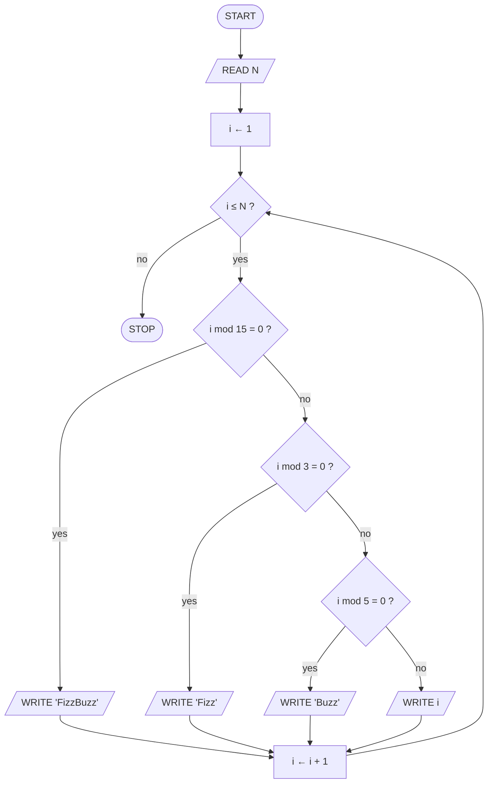
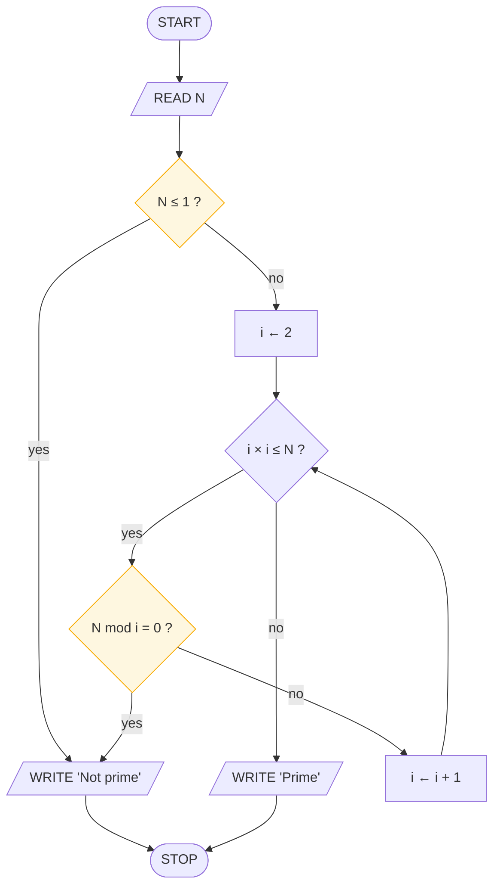
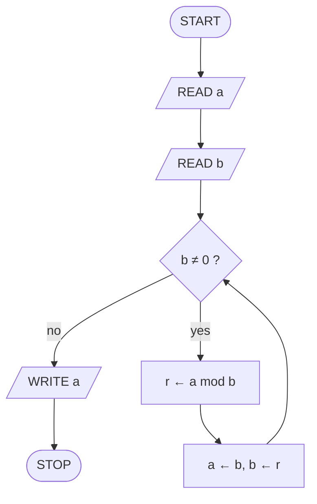
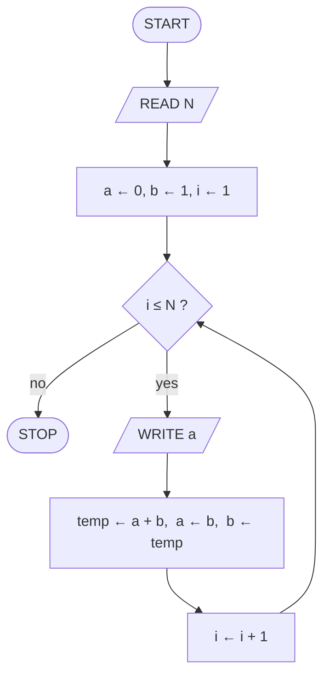
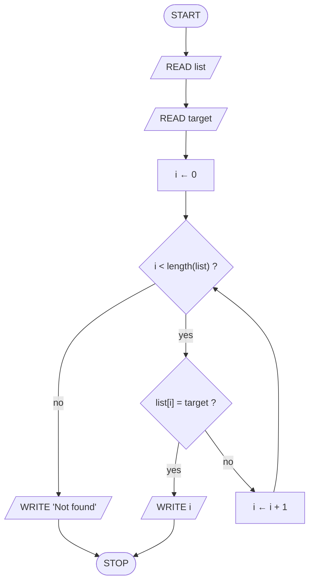
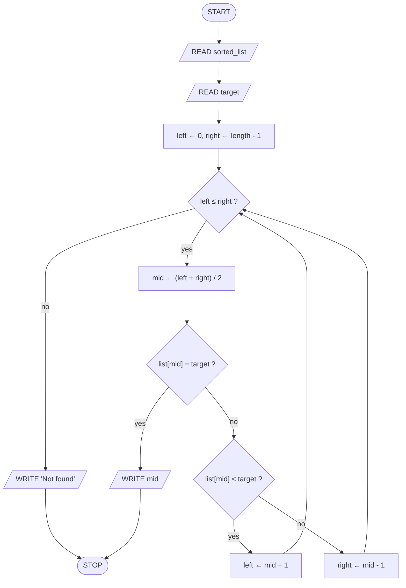
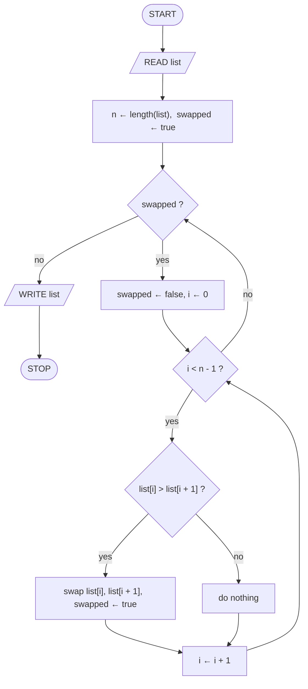
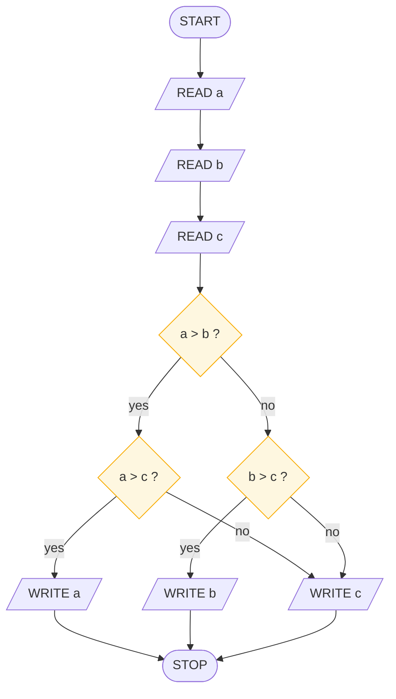
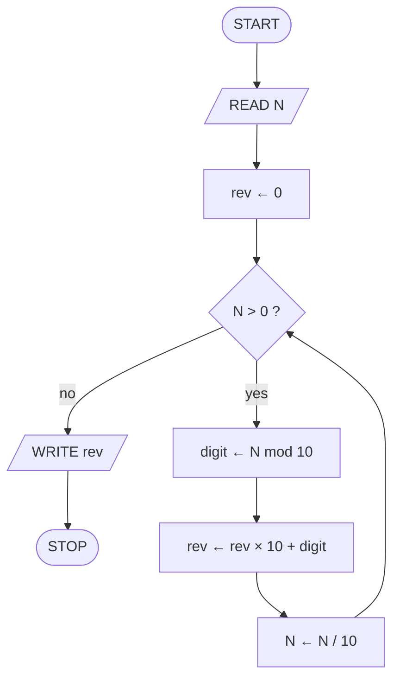
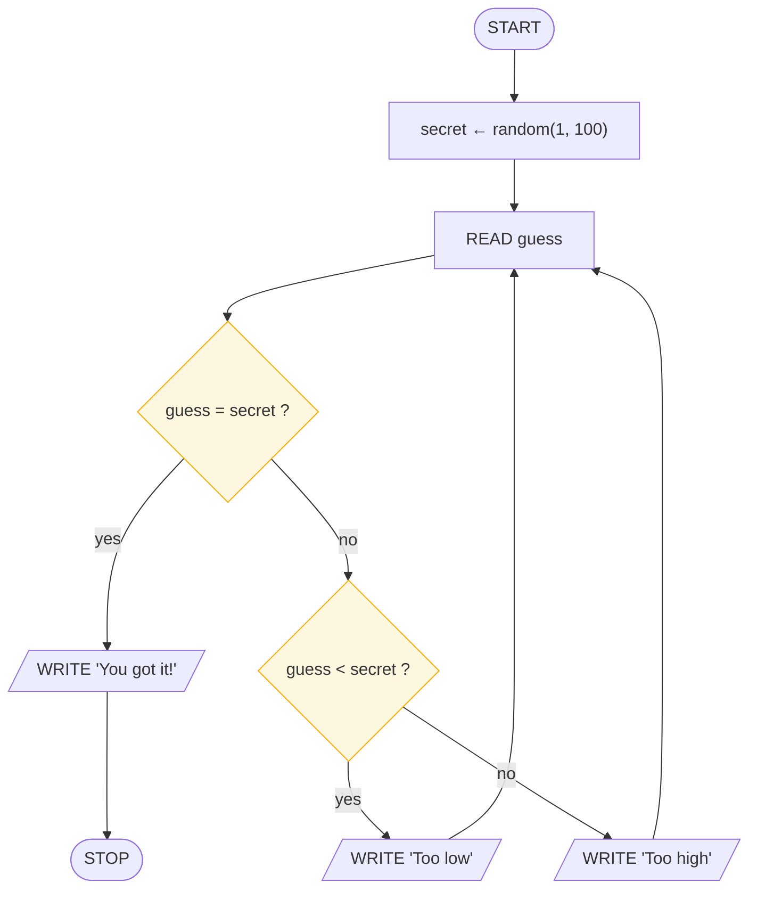

# Classic Algorithms

> **Lesson 7 of 9** — Ten classic algorithms, each with a Mermaid flowchart,
> pseudocode, and a brief explanation. Simple to medium difficulty.

---

## 1. FizzBuzz

Print numbers 1 to N. For multiples of 3, print "Fizz". For multiples of 5,
print "Buzz". For multiples of both, print "FizzBuzz".



```
FOR i FROM 1 TO N DO
    IF i MOD 15 = 0 THEN WRITE "FizzBuzz"
    ELSE IF i MOD 3 = 0 THEN WRITE "Fizz"
    ELSE IF i MOD 5 = 0 THEN WRITE "Buzz"
    ELSE WRITE i
END FOR
```

Check 15 first — otherwise "Fizz" or "Buzz" catches it before "FizzBuzz" can.

---

## 2. Prime Test

Check whether a number N is prime (divisible only by 1 and itself).



```
IF N ≤ 1 THEN WRITE "Not prime"; STOP
i ← 2
WHILE i × i ≤ N DO
    IF N MOD i = 0 THEN WRITE "Not prime"; STOP
    i ← i + 1
END WHILE
WRITE "Prime"
```

No need to check beyond √N — if a factor exists above √N, its pair is below.

---

## 3. GCD (Euclid's Algorithm)

Find the greatest common divisor of two numbers using repeated division.



```
READ a, b
WHILE b ≠ 0 DO
    r ← a MOD b
    a ← b
    b ← r
END WHILE
WRITE a
```

Euclid figured this out around 300 BC. The remainder becomes the new divisor.

---

## 4. Fibonacci Sequence

Print the first N Fibonacci numbers, where each is the sum of the two before.



```
a ← 0, b ← 1
FOR i FROM 1 TO N DO
    WRITE a
    temp ← a + b
    a ← b
    b ← temp
END FOR
```

Trace for N = 5: prints 0, 1, 1, 2, 3.

---

## 5. Linear Search

Find a target value in a list by checking each element in order.



```
FOR i FROM 0 TO length(list) - 1 DO
    IF list[i] = target THEN WRITE i; STOP
END FOR
WRITE "Not found"
```

Simple but slow for large lists — checks every element one by one.

---

## 6. Binary Search

Find a target in a **sorted** list by halving the search space each step.



```
left ← 0, right ← length(list) - 1
WHILE left ≤ right DO
    mid ← (left + right) / 2
    IF list[mid] = target THEN WRITE mid; STOP
    ELSE IF list[mid] < target THEN left ← mid + 1
    ELSE right ← mid - 1
END WHILE
WRITE "Not found"
```

Requires a sorted list. Each comparison discards half the remaining items.

---

## 7. Bubble Sort

Sort a list by repeatedly comparing adjacent pairs and swapping if needed.



```
swapped ← true
WHILE swapped DO
    swapped ← false
    FOR i FROM 0 TO n - 2 DO
        IF list[i] > list[i + 1] THEN
            swap list[i] and list[i + 1]
            swapped ← true
        END IF
    END FOR
END WHILE
```

After each pass, the largest unsorted element "bubbles up" to its position.

---

## 8. Largest of Three

Find the largest among three numbers using pairwise comparison.



```
READ a, b, c
IF a > b THEN
    IF a > c THEN WRITE a
    ELSE WRITE c
ELSE
    IF b > c THEN WRITE b
    ELSE WRITE c
END IF
```

Two comparisons are enough — no need to check all three pairs.

---

## 9. Reversing Digits

Reverse the digits of a positive integer (e.g., 1234 becomes 4321).



```
rev ← 0
WHILE N > 0 DO
    digit ← N MOD 10
    rev ← rev × 10 + digit
    N ← N / 10
END WHILE
WRITE rev
```

Trace for N = 1234: rev goes 0 → 4 → 43 → 432 → 4321.

---

## 10. Guess the Number

The computer picks a random number; the player guesses until correct.



```
secret ← random number between 1 and 100
REPEAT
    READ guess
    IF guess = secret THEN WRITE "You got it!"
    ELSE IF guess < secret THEN WRITE "Too low"
    ELSE WRITE "Too high"
UNTIL guess = secret
```

A `repeat–until` loop — the player must guess at least once.

---

## What to take away

- Ten algorithms, three patterns — every one is sequence, selection, and
  iteration wearing a different costume
- Trace each flowchart by hand before writing code
- The `mod` operator (%) is your friend: primes, FizzBuzz, reversing digits
- Sorted data unlocks binary search — the same list, a different algorithm

## Next

**[IPO and State](08-ipo-and-state.md)** — where data comes from, where it goes,
and what the program remembers along the way.

---

## Persian

[الگوریتم‌های کلاسیک](07-classic-algorithms_fa.md)
