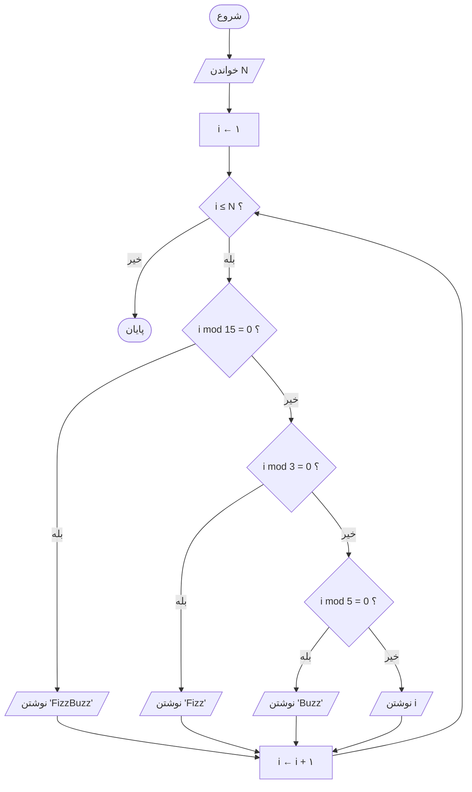
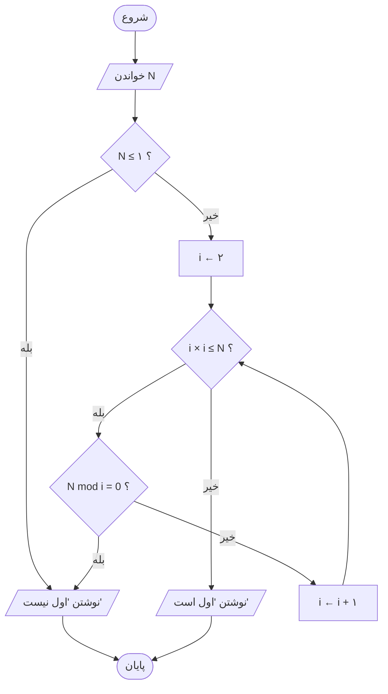
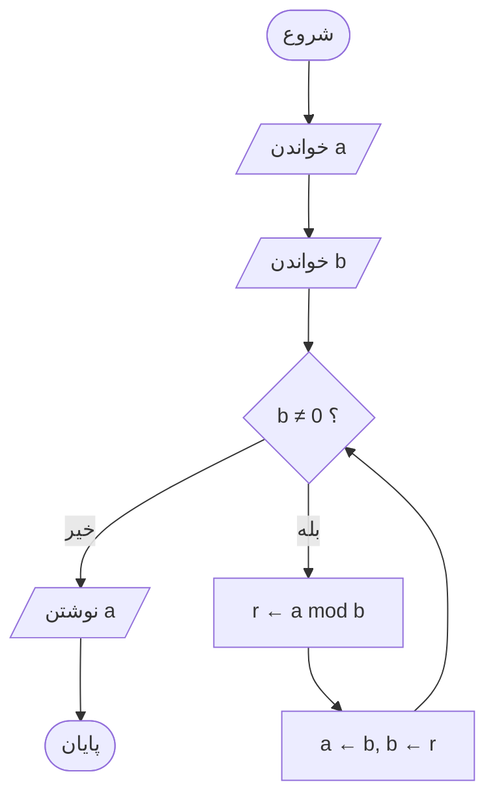
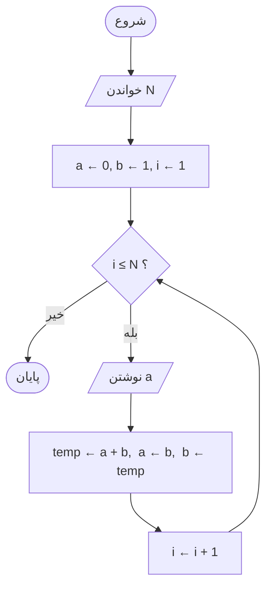
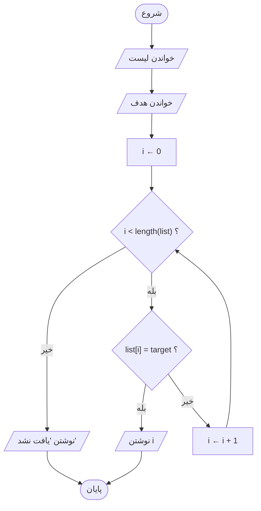
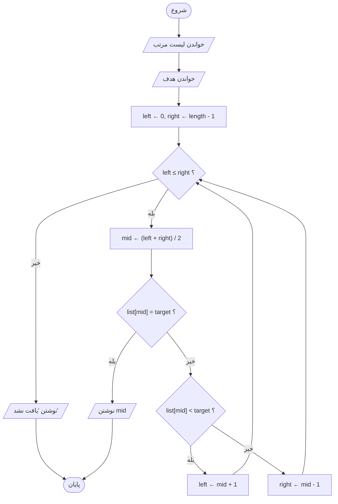
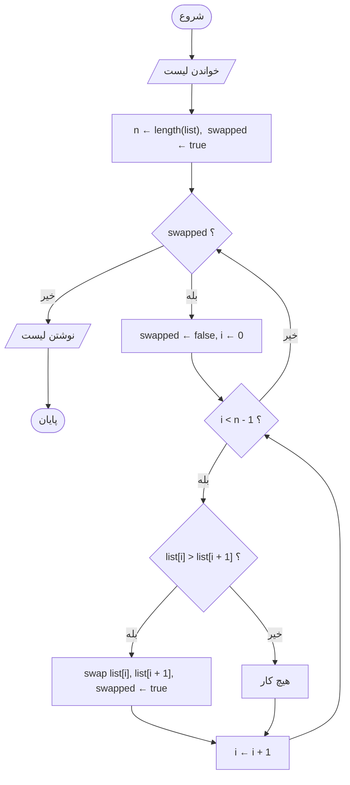
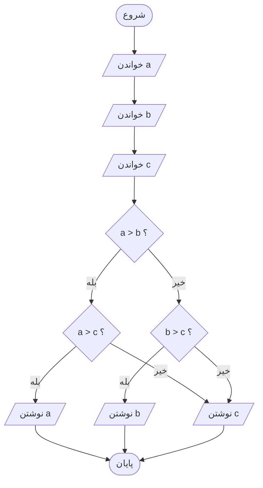
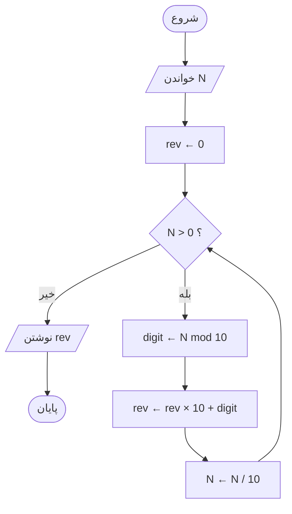
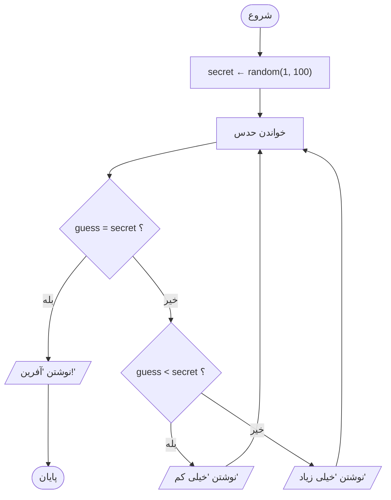

# الگوریتم‌های کلاسیک

> **درس ۷ از ۹** — ده الگوریتم کلاسیک، هرکدام با فلوچارت Mermaid،
> شبه‌کد و توضیح کوتاه. سختی متوسط.

---

## ۱. FizzBuzz

اعداد ۱ تا N را چاپ کن. برای مضرب‌های ۳، «Fizz» چاپ کن. برای مضرب‌های ۵،
«Buzz». برای مضرب‌های هر دو، «FizzBuzz».



```
FOR i FROM 1 TO N DO
    IF i MOD 15 = 0 THEN WRITE "FizzBuzz"
    ELSE IF i MOD 3 = 0 THEN WRITE "Fizz"
    ELSE IF i MOD 5 = 0 THEN WRITE "Buzz"
    ELSE WRITE i
END FOR
```

اول ۱۵ را بررسی کن — در غیر این صورت «Fizz» یا «Buzz» آن را قبل از
«FizzBuzz» می‌گیرد.

---

## ۲. تست اول بودن

بررسی کن که آیا عدد N اول است (فقط بر ۱ و خودش بخش‌پذیر باشد).



```
IF N ≤ 1 THEN WRITE "اول نیست"; STOP
i ← 2
WHILE i × i ≤ N DO
    IF N MOD i = 0 THEN WRITE "اول نیست"; STOP
    i ← i + 1
END WHILE
WRITE "اول است"
```

نیازی به بررسی فراتر از √N نیست — اگر عاملی بالاتر از √N باشد، جفت آن
پایین‌تر است.

---

## ۳. ب‌م‌م (الگوریتم اقلیدسی)

بزرگ‌ترین مقسوم‌علیه مشترک دو عدد را با تقسیم متكرر پیدا کن.



```
READ a, b
WHILE b ≠ 0 DO
    r ← a MOD b
    a ← b
    b ← r
END WHILE
WRITE a
```

اقلیدس این را حدود ۳۰۰ قبل از میلاد کشف کرد. باقیمانده مقسوم‌علیه جدید می‌شود.

---

## ۴. نبض فیبوناچی

N عدد اول فیبوناچی را چاپ کن، که هرکدام جمع دو عدد قبلی است.



```
a ← 0, b ← 1
FOR i FROM 1 TO N DO
    WRITE a
    temp ← a + b
    a ← b
    b ← temp
END FOR
```

برای N = ۵: ۰، ۱، ۱، ۲، ۳ چاپ می‌شود.

---

## ۵. جست‌وجوی خطی

مقدار هدف را در یک لیست با بررسی ترتیبی هر عنصر پیدا کن.



```
FOR i FROM 0 TO length(list) - 1 DO
    IF list[i] = target THEN WRITE i; STOP
END FOR
WRITE "یافت نشد"
```

ساده اما برای لیست‌های بزرگ کند — هر عنصر را یکی یکی بررسی می‌کند.

---

## ۶. جست‌وجوی دودویی

هدف را در یک لیست **مرتب** با نصف کردن فضای جست‌وجو در هر مرحله پیدا کن.



```
left ← 0, right ← length(list) - 1
WHILE left ≤ right DO
    mid ← (left + right) / 2
    IF list[mid] = target THEN WRITE mid; STOP
    ELSE IF list[mid] < target THEN left ← mid + 1
    ELSE right ← mid - 1
END WHILE
WRITE "یافت نشد"
```

نیاز به لیست مرتب دارد. هر مقایسه نصف باقی‌مانده را دور می‌ریزد.

---

## ۷. مرتب‌سازی حبابی

لیست را با مقایسه و جابه‌جاکردن متوالی جفت‌های مجاور مرتب کن.



```
swapped ← true
WHILE swapped DO
    swapped ← false
    FOR i FROM 0 TO n - 2 DO
        IF list[i] > list[i + 1] THEN
            swap list[i] and list[i + 1]
            swapped ← true
        END IF
    END FOR
END WHILE
```

بعد از هر _pass، بزرگ‌ترین عنصر مرتب‌نشده به جایش «حباب» می‌رود.

---

## ۸. بزرگ‌ترینِ سه عدد

بزرگ‌ترین را بین سه عدد با مقایسه جفتی پیدا کن.



```
READ a, b, c
IF a > b THEN
    IF a > c THEN WRITE a
    ELSE WRITE c
ELSE
    IF b > c THEN WRITE b
    ELSE WRITE c
END IF
```

دو مقایسه کافی است — نیازی به بررسی هر سه جفت نیست.

---

## ۹. معکوس کردن ارقام

ارقام یک عدد صحیح مثبت را معکوس کن (مثلاً ۱۲۳۴ می‌شود ۴۳۲۱).



```
rev ← 0
WHILE N > 0 DO
    digit ← N MOD 10
    rev ← rev × 10 + digit
    N ← N / 10
END WHILE
WRITE rev
```

برای N = ۱۲۳۴: rev می‌رود ۰ ← ۴ ← ۴۳ ← ۴۳۲ ← ۴۳۲۱.

---

## ۱۰. حدس عدد

کامپیوتر یک عدد تصادفی انتخاب می‌کند؛ بازیکن تا درست حدس زدن ادامه می‌دهد.



```
secret ← random number between 1 and 100
REPEAT
    READ guess
    IF guess = secret THEN WRITE "آفرین!"
    ELSE IF guess < secret THEN WRITE "خیلی کم"
    ELSE WRITE "خیلی زیاد"
UNTIL guess = secret
```

یک حلقه repeat–until — بازیکن باید دست‌کم یک بار حدس بزند.

---

## آنچه باید به خاطر بسپارید

- ده الگوریتم، سه الگو — هرکدام ترتیب، انتخاب و تکرار با لباسی متفاوت
- هر فلوچارت را پیش از نوشتن کد با دست ردیابی کن
- عملگر `mod` (%) دوست توست: اعداد اول، FizzBuzz، معکوس کردن ارقام
- داده مرتب، جست‌وجوی دودویی را باز می‌کند — همان لیست، الگوریتم متفاوت

## بعدی

**[ورودی، پردازش، خروجی و حالت](08-ipo-and-state_fa.md)** — داده‌ها از کجا می‌آیند،
به کجا می‌روند و برنامه در مسیر چه چیزی به خاطر می‌سپارد.

---

## English

[Classic Algorithms](07-classic-algorithms.md)
