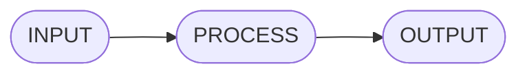
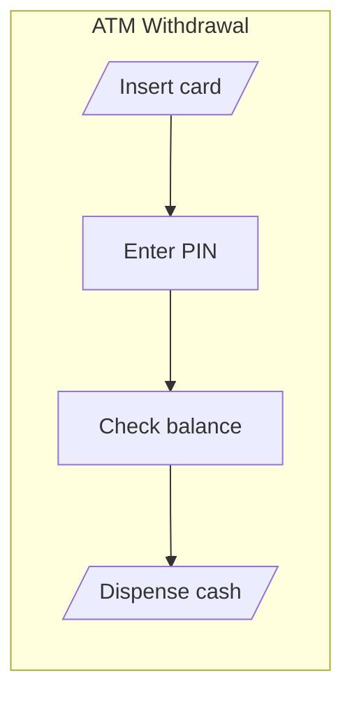
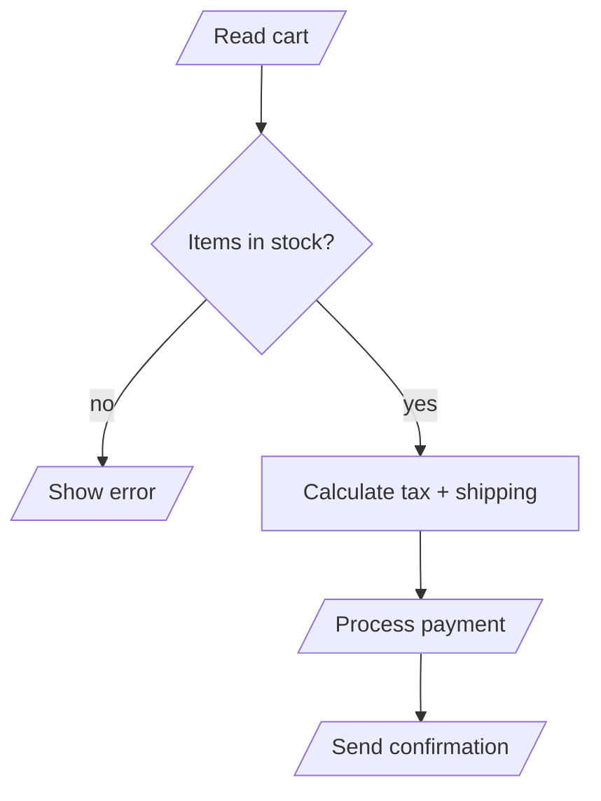
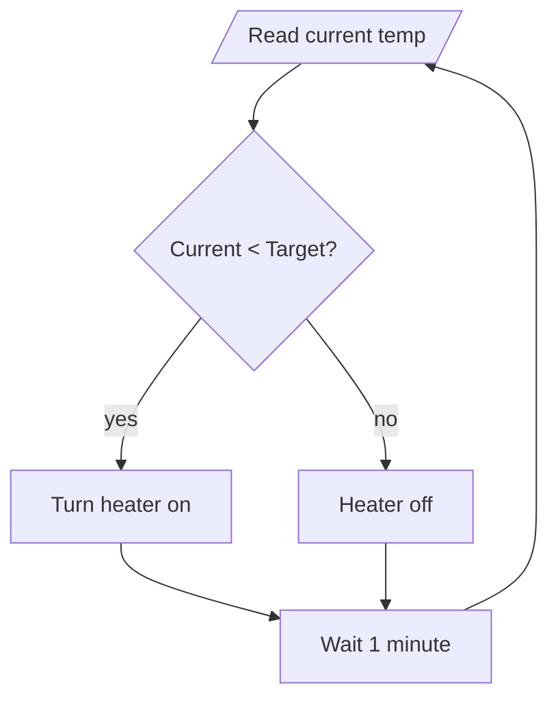
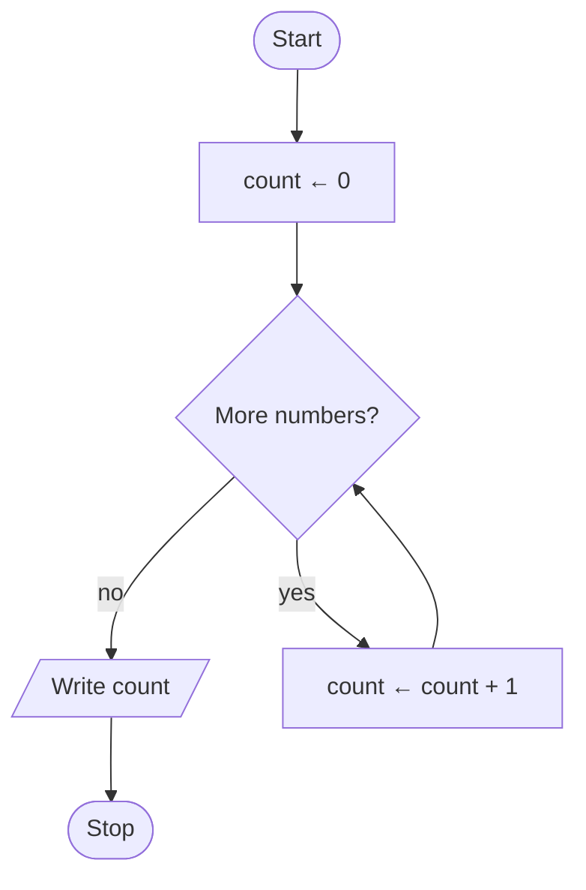
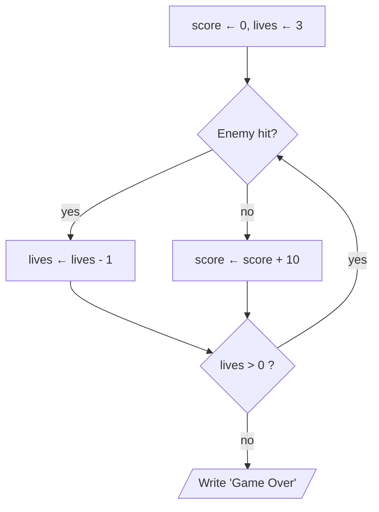

# IPO and State

> **Lesson 8 of 9** — Input, Process, Output: the universal pattern behind
> every program. Plus state: what the program remembers between steps.

---

## The IPO pattern

Every system — a coffee machine, a calculator, a web browser — follows the
same skeleton:



- **Input** — data coming in: a number, a name, a button press
- **Process** — work done on that data: calculate, decide, transform
- **Output** — results going out: a display, a file, a sound



```
INPUT:  card, PIN, amount
PROCESS: verify PIN → check balance → dispense cash → update balance
OUTPUT: cash, receipt, new balance
```

## Real-world IPO examples

### Online shopping

```
INPUT:  shopping cart items, payment method, shipping address
PROCESS: validate inventory → calculate tax and shipping → charge payment → update stock
OUTPUT: order confirmation, receipt, tracking number
```



### Thermostat

```
INPUT:  current temperature, target temperature
PROCESS: compare → decide heating or idle → adjust
OUTPUT: heater on/off, updated room temperature
```



## State: what the program remembers

**State** is all the data a program is currently tracking. Without it, every
calculation would start from nothing.

**Example: a simple counter**



| Step | Input | State (count) |
|------|-------|---------------|
| init | — | 0 |
| 1 | 5 | 1 |
| 2 | 3 | 2 |
| 3 | 8 | 3 |
| exit | — | WRITE 3 |

The accumulator `count` is state. It persists across loop iterations.

## Types of state

| Type | What it tracks | Example |
|------|---------------|---------|
| **Counter** | How many times something happened | login attempts |
| **Accumulator** | Running total | shopping cart total |
| **Flag** | Whether something is true | `logged_in`, `game_over` |
| **Current value** | The best so far | highest score |

## State in a game



Three pieces of state: `score`, `lives`, and the play-again flag. Each
iteration of the loop updates one or more of them.

## IPO analysis template

Use this template for any problem:

```
PROBLEM: [Describe the problem]

INPUT:
- Data: [What data comes in?]
- Constraints: [Valid ranges, required fields]

PROCESS:
- Step 1: [First operation]
- Step 2: [Next operation]
- Decisions: [What conditions to check?]

OUTPUT:
- Result: [What to produce?]
- Format: [How to present it?]

STATE TRACKING:
- Initial: [Starting values]
- During: [What changes?]
- Final: [Ending values]
```

## What to take away

- IPO is universal: every program follows Input → Process → Output
- State is the data a program remembers between steps
- Counters, accumulators, flags, and current values are the four basic types
- Always list your inputs and outputs before drawing any flowchart

## Next

**[Algorithm Characteristics](09-algorithm-characteristics.md)** — what makes
something a valid algorithm: the FIDEO checklist.

---

## Persian

[ورودی، پردازش، خروجی و حالت](08-ipo-and-state_fa.md)
