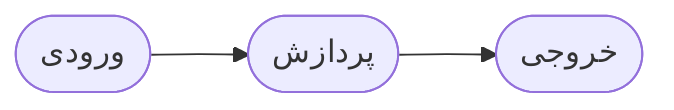
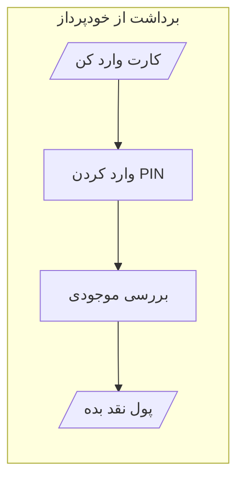
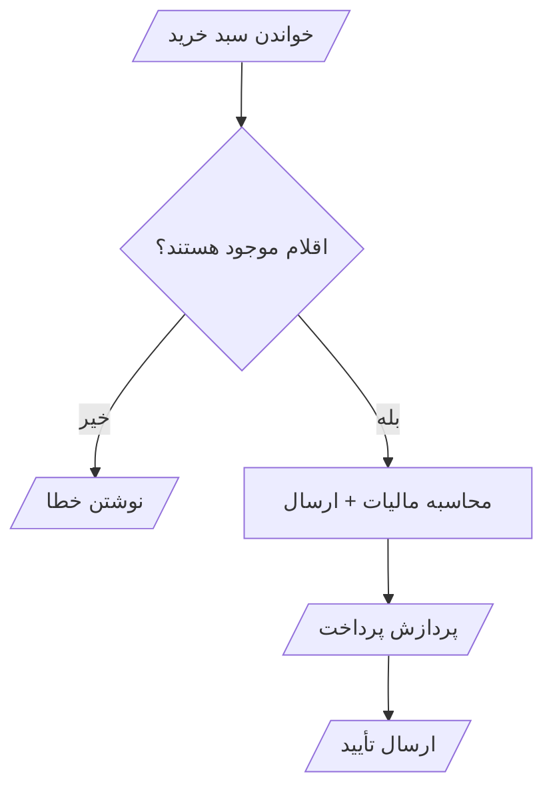
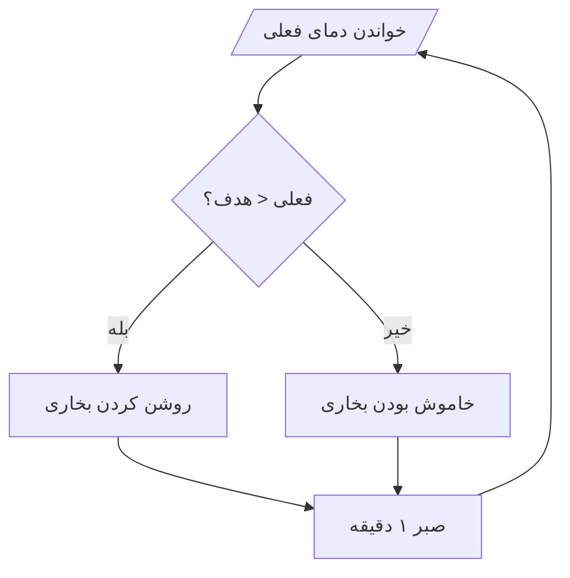
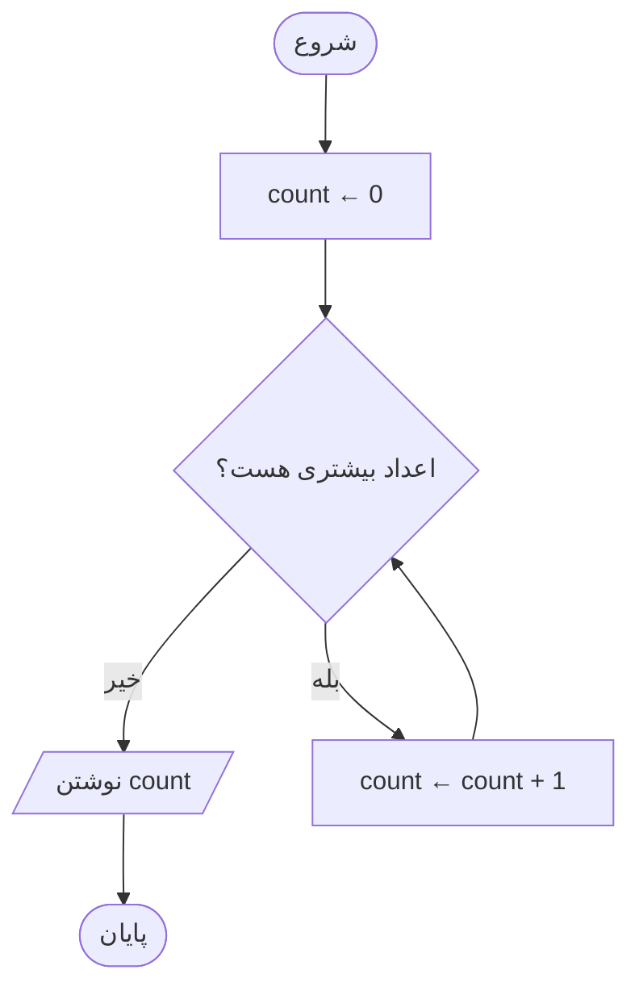
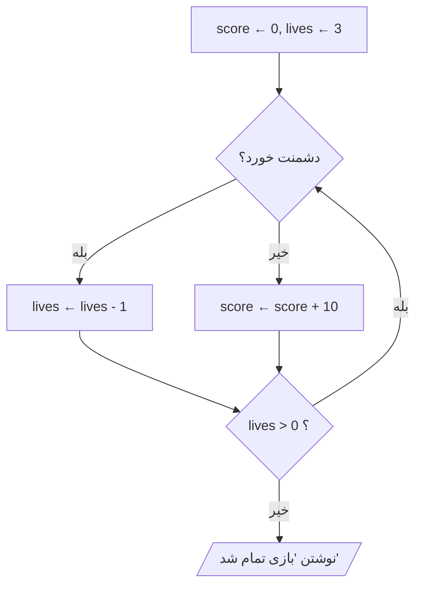

# ورودی، پردازش، خروجی و حالت

> **درس ۸ از ۹** — ورودی، پردازش، خروجی: الگوی جهانی پشت هر برنامه.
> به‌علاوه حالت: آنچه برنامه بین گام‌ها به خاطر می‌سپارد.

---

## الگوی IPO

هر سیستم — یک قهوه‌ساز، یک ماشین‌حساب، یک مرورگر وب — همان اسکلت را دنبال
می‌کند:



- **ورودی** — داده‌ای که وارد می‌شود: یک عدد، یک نام، یک فشردن دکمه
- **پردازش** — کاری که روی آن داده انجام می‌شود: محاسبه، تصمیم، تبدیل
- **خروجی** — نتایجی که بیرون می‌روند: یک نمایشگر، یک فایل، یک صدا



```
ورودی:  کارت، PIN، مبلغ
پردازش: تأیید PIN ← بررسی موجودی ← پول نقد ← به‌روزرسانی موجودی
خروجی: پول نقد، رسید، موجودی جدید
```

## نمونه‌های IPO در دنیای واقعی

### خرید آنلاین

```
ورودی:  اقلام سبد خرید، روش پرداخت، آدرس ارسال
پردازش: تأیید موجودی ← محاسبه مالیات و ارسال ← شارژ پرداخت ← به‌روزرسانی موجودی
خروجی: تأیید سفارش، رسید، شماره رهگیری
```



### ترموستات

```
ورودی:  دمای فعلی، دمای هدف
پردازش: مقایسه ← تصمیم برای گرمایش یا بی‌کاری ← تنظیم
خروجی: روشن/خاموش بودن بخاری، دمای به‌روزشده اتاق
```



## حالت: آنچه برنامه به خاطر می‌سپارد

**حالت** تمام داده‌هایی است که یک برنامه در حال پیگیری است. بدون آن، هر
محاسبه از هیچ شروع می‌شود.

**مثال: یک شمارنده ساده**



| گام | ورودی | حالت (count) |
|-----|-------|-------------|
| مقداردهی | — | 0 |
| ۱ | 5 | 1 |
| ۲ | 3 | 2 |
| ۳ | 8 | 3 |
| خروج | — | نوشتن 3 |

انباشتگ `count` حالت است. در طول تکرارهای حلقه باقی می‌ماند.

## انواع حالت

| نوع | چه چیزی را پیگیری می‌کند | مثال |
|-----|----------------------|------|
| **شمارنده** | چند بار چیزی اتفاق افتاده | تلاش‌های ورود |
| **انباشتگ** | مجموع در حال اجرا | مجموع سبد خرید |
| **پرچم** | آیا چیزی درست است | `logged_in`، `game_over` |
| **مقدار فعلی** | بهترین تاکنون | بالاترین امتیاز |

## حالت در یک بازی



سه بخش حالت: `score`، `lives` و پرچم ادامه بازی. هر تکرار حلقه یکی یا
بیشتر را به‌روز می‌کند.

## قالب تحلیل IPO

از این قالب برای هر مسئله استفاده کن:

```
مسئله: [توضیح مسئله]

ورودی:
- داده: [چه داده‌ای وارد می‌شود؟]
- محدودیت‌ها: [بازه‌های معتبر، فیلدهای الزامی]

پردازش:
- گام ۱: [اولین عملیات]
- گام ۲: [عملیات بعدی]
- تصمیم‌ها: [چه شرط‌هایی بررسی شود؟]

خروجی:
- نتیجه: [چه چیزی تولید شود؟]
- قالب: [چگونه ارائه شود؟]

پیگیری حالت:
- اولیه: [مقادیر شروع]
- حین اجرا: [چه چیزی تغییر می‌کند؟]
- نهایی: [مقادیر پایانی]
```

## آنچه باید به خاطر بسپارید

- IPO جهانی است: هر برنامه ورودی ← پردازش ← خروجی را دنبال می‌کند
- حالت داده‌هایی است که برنامه بین گام‌ها به خاطر می‌سپارد
- شمارنده‌ها، انباشتگ‌ها، پرچم‌ها و مقادیر فعلی چهار نوع پایه هستند
- همیشه ورودی‌ها و خروجی‌ها را پیش از رسم هر فلوچارتی فهرست کن

## بعدی

**[ویژگی‌های الگوریتم](09-algorithm-characteristics_fa.md)** — چه چیزی یک رویه را
الگوریتم می‌کند: چک‌لیست FIDEO.

---

## English

[IPO and State](08-ipo-and-state.md)
