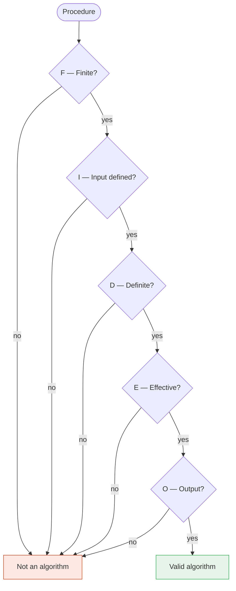
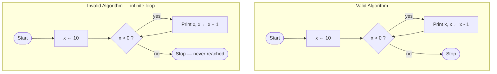

# Algorithm Characteristics: The FIDEO Framework

> **Lesson 9 of 9** — What makes something an algorithm? Five essential
> characteristics you can check against any procedure.

---

## What is an algorithm?

An **algorithm** is a finite set of clear, step-by-step instructions to solve
a problem or accomplish a task.

**Not an algorithm:**

```
How to make tea:
1. Boil some water
2. Add tea leaves
3. Wait a bit
4. Drink when ready
```

Problems: "some" is vague, "a bit" is unclear, "when ready" is subjective.

**Algorithm version:**

```
Input:  2 cups water, 1 tea bag, 1 teaspoon sugar (optional)

1. Pour 2 cups water into kettle
2. Heat water to 100°C (boiling)
3. Place tea bag in cup
4. Pour boiling water over tea bag
5. Wait exactly 3 minutes
6. Remove tea bag
7. If sugar desired, add 1 teaspoon and stir
8. Serve immediately

Output: 1 cup of brewed tea
```

The difference: precise steps, clear inputs, defined output.

## The FIDEO checklist

Every algorithm must satisfy five characteristics. Remember **FIDEO**:

| Letter | Characteristic | Question to ask |
|--------|---------------|-----------------|
| **F** | **Finite** — it must end | "Will it eventually stop?" |
| **I** | **Input** — it accepts data | "What information does it need?" |
| **D** | **Definite** — every step is clear | "Can a computer follow this exactly?" |
| **E** | **Effective** — every step is doable | "Is each step actually possible?" |
| **O** | **Output** — it produces a result | "What do we get at the end?" |



## F — Finite

An algorithm must complete after a specific, finite number of steps.

**Good (finite):**

```
1. Set n ← 1
2. Print n
3. If n = 10, stop
4. Set n ← n + 1
5. Go back to step 2
```

**Bad (infinite):**

```
1. Set n ← 1
2. Print n
3. Set n ← n + 1
4. Go back to step 2   ← never stops!
```

Ask yourself: "Will this eventually stop on ALL possible inputs?"

## I — Input

An algorithm clearly defines what data it works with. Zero inputs is valid.

**With input:**

```
Input: width and height
Process: area ← width × height
Output: area
```

**Zero input:**

```
Input: (none — reads system clock)
Process: read current time
Output: "Today is Monday"
```

## D — Definite

Each step must be so precise that anyone (or any computer) can follow it
without guessing.

| Vague | Definite |
|-------|----------|
| "Boil some water" | "Heat 2 cups of water to 100°C" |
| "Add tea" | "Add 1 tea bag" |
| "Wait a while" | "Steep for 3 minutes" |
| "Add sugar if you want" | "Add 1 teaspoon sugar (optional)" |

Computers are extremely literal. They cannot guess what you mean.

## E — Effective

Each operation must be simple enough to be performed exactly, in finite time.

**Effective operations:**

- Arithmetic: `+`, `-`, `*`, `/`
- Comparisons: `<`, `>`, `=`
- Reading input, printing output

**Ineffective operations:**

- "Read the user's mind"
- "Make everyone happy"
- "Solve world hunger"

## O — Output

An algorithm must produce at least one well-defined output.

**Good output:**

```
Output: maximum value in the list
```

**No output:**

```
(Process runs but produces nothing usable)
```

## Practice: is it an algorithm?

**Procedure A:**

```
1. Get a number from user
2. If number > 0, print "positive"
3. If number < 0, print "negative"
4. Else print "zero"
```

| Criterion | Check |
|-----------|-------|
| Finite | Yes — 3 steps |
| Input | Yes — one number |
| Definite | Yes — clear conditions |
| Effective | Yes — comparisons and prints |
| Output | Yes — prints a result |

**Verdict:** Valid algorithm.

**Procedure B:**

```
1. Set x ← 1
2. While x > 0:
   - Print x
   - x ← x + 1
```

| Criterion | Check |
|-----------|-------|
| Finite | No — x grows forever |
| Input | OK (zero is allowed) |
| Definite | Yes |
| Effective | Yes |
| Output | Yes (but infinite) |

**Verdict:** Not an algorithm — fails finiteness.

## Mermaid flowchart: valid vs invalid



The only difference: `x ← x - 1` vs `x ← x + 1`. One character makes the
difference between a valid algorithm and an infinite loop.

## What to take away

- FIDEO defines what makes an algorithm — not just any set of steps
- Finiteness is crucial: infinite loops are not algorithms
- Definiteness prevents bugs: unclear steps lead to wrong results
- Effectiveness keeps it practical: each step must be possible
- Input and output define the interface: how the algorithm talks to the world

## Next

Congratulations — you have completed all nine lessons. You can now draw
flowcharts, trace algorithms, apply the IPO pattern, and evaluate procedures
against FIDEO. When you reach the Python modules, translating your charts
into code will feel mechanical.

---

## Persian

[ویژگی‌های الگوریتم](09-algorithm-characteristics_fa.md)
