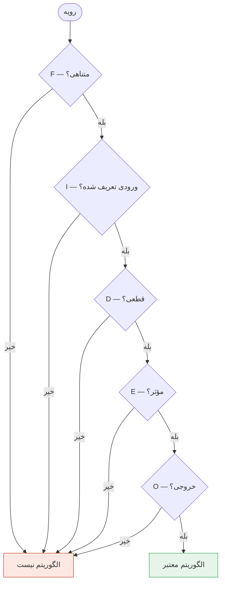
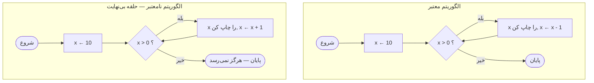

# ویژگی‌های الگوریتم: چارچوب FIDEO

> **درس ۹ از ۹** — چه چیزی یک رویه را الگوریتم می‌کند؟ پنج ویژگی ضروری
> که می‌توانید روی هر رویه بررسی کنید.

---

## الگوریتم چیست؟

**الگوریتم** مجموعه‌ای متناهی از دستورالعمل‌های واضح و گام‌به‌گام برای حل
یک مسئله یا انجام یک وظیفه است.

**الگوریتم نیست:**

```
چطور چای درست کنیم:
۱. کمی آب بجوشان
۲. برگ چای اضافه کن
۳. کمی صبر کن
۴. وقتی آماده شد بنوش
```

مشکلات: «کمی» مبهم است، «کمی صبر» نامشخص است، «وقتی آماده شد» ذهنی است.

**نسخه الگوریتمی:**

```
ورودی:  ۲ پیمانه آب، ۱ کیسه چای، ۱ قاشق چای‌خوری شکر (اختیاری)

۱. ۲ پیمانه آب را در کتری بریز
۲. آب را تا ۱۰۰ درجه سانتی‌گراد بجوشان
۳. کیسه چای را در فنجان بگذار
۴. آب جوش را روی کیسه چای بریز
۵. دقیقاً ۳ دقیقه صبر کن
۶. کیسه چای را خارج کن
۷. اگر شکر می‌خواهی، ۱ قاشق چای‌خوری اضافه کن و هم بزن
۸. فوراً سرو کن

خروجی: ۱ فنجان چای دم‌کرده
```

تفاوت: گام‌های دقیق، ورودی واضح، خروجی تعریف‌شده.

## چک‌لیست FIDEO

هر الگوریتم باید پنج ویژگی را برآورده کند. **FIDEO** را به خاطر بسپار:

| حرف | ویژگی | پرسش |
|-----|-------|------|
| **F** | **متناهی** — باید پایان یابد | «آیا در نهایت متوقف می‌شود؟» |
| **I** | **ورودی** — داده می‌پذیرد | «چه اطلاعاتی نیاز دارد؟» |
| **D** | **قطعی** — هر گام واضح است | «آیا کامپیوتر می‌تواند دقیقاً دنبال کند؟» |
| **E** | **مؤثر** — هر گام انجام‌پذیر است | «آیا هر گام واقعاً ممکن است؟» |
| **O** | **خروجی** — نتیجه تولید می‌کند | «در پایان چه چیزی به دست می‌آید؟» |



## F — متناهی

الگوریتم باید پس از تعداد مشخص و متناهی گام کامل شود.

**خوب (متناهی):**

```
۱. x ← ۱۰
۲. x را چاپ کن
۳. اگر x = ۰ شد، متوقف شو
۴. x ← x - ۱
۵. به گام ۲ برگرد
```

**بد (بی‌نهایت):**

```
۱. x ← ۱۰
۲. x را چاپ کن
۳. x ← x + ۱
۴. به گام ۲ برگرد   ← هرگز متوقف نمی‌شود!
```

از خود بپرس: «آیا این رویه روی همه ورودی‌های ممکن در نهایت متوقف می‌شود؟»

## I — ورودی

الگوریتم باید داده‌ای که با آن کار می‌کند را تعریف کند. صفر ورودی هم معتبر است.

**با ورودی:**

```
ورودی: عرض و ارتفاع
پردازش: مساحت ← عرض × ارتفاع
خروجی: مساحت
```

**بدون ورودی:**

```
ورودی: (هیچ — از سیستم می‌خواند)
پردازش: خواندن زمان فعلی
خروجی: «امروز دوشنبه است»
```

## D — قطعی

هر گام باید آن‌قدر دقیق باشد که هر کس (یا هر کامپیوتر) بدون حدس بتواند آن را
دنبال کند.

| مبهم | قطعی |
|------|-------|
| «کمی آب بجوشان» | «۲ پیمانه آب را تا ۱۰۰ درجه بجوشان» |
| «چای اضافه کن» | «۱ کیسه چای اضافه کن» |
| «کمی صبر کن» | «۳ دقیقه صبر کن» |
| «اگر بخواهی شکر اضافه کن» | «۱ قاشق چای‌خوری شکر اضافه کن (اختیاری)» |

کامپیوترها بسیار تحت‌الحرفی هستند. نمی‌توانند منظور را حدس بزنند.

## E — مؤثر

هر عملیات باید آن‌قدر ساده باشد که دقیقاً و در زمان متناهی قابل انجام باشد.

**عملیات‌های مؤثر:**

- محاسبات: `+`، `-`، `*`، `/`
- مقایسه‌ها: `<`، `>`، `=`
- خواندن ورودی، چاپ خروجی

**عملیات‌های غیرمؤثر:**

- «ذهن کاربر را بخوان»
- «همه را خوشحال کن»
«گرسنگی جهان را حل کن»

## O — خروجی

الگوریتم باید دست‌کم یک خروجی خوش‌تعریف تولید کند.

**خروجی خوب:**

```
خروجی: بزرگ‌ترین مقدار در لیست
```

**بدون خروجی:**

```
(پردازش انجام می‌شود ولی چیز قابل‌استفاده‌ای تولید نمی‌کند)
```

## تمرین: آیا الگوریتم است؟

**رویه A:**

```
۱. یک عدد از کاربر بگیر
۲. اگر عدد > ۰ بود، «مثبت» چاپ کن
۳. اگر عدد < ۰ بود، «منفی» چاپ کن
۴. در غیر این صورت «صفر» چاپ کن
```

| معیار | بررسی |
|-------|-------|
| متناهی | بله — ۳ گام |
| ورودی | بله — یک عدد |
| قطعی | بله — شرط‌های واضح |
| مؤثر | بله — مقایسه و چاپ |
| خروجی | بله — نتیجه چاپ می‌شود |

**حکم:** الگوریتم معتبر است.

**رویه B:**

```
۱. x ← ۱
۲. تا وقتی x > ۰:
   - x را چاپ کن
   - x ← x + ۱
```

| معیار | بررسی |
|-------|-------|
| متناهی | خیر — x برای همه بزرگ‌تر می‌شود |
| ورودی | مشکلی نیست (صفر مجاز است) |
| قطعی | بله |
| مؤثر | بله |
| خروجی | بله (اما بی‌نهایت) |

**حکم:** الگوریتم نیست — متناهی نیست.

## فلوچارت Mermaid: معتبر در برابر نامعتبر



تنها تفاوت: `x ← x - 1` در برابر `x ← x + 1`. یک کاراکتر تفاوت بین یک
الگوریتم معتبر و یک حلقه بی‌نهایت است.

## آنچه باید به خاطر بسپارید

- FIDEO تعریف می‌کند چه چیزی یک الگوریتم است — نه هر مجموعه دستورالعملی
- متاهی حیاتی است: حلقه‌های بی‌نهایت الگوریتم نیستند
- قطعی بودن از اشکالات جلوگیری می‌کند: گام‌های نامشخص به نتایج غلط می‌انجامند
- مؤثر بودن آن را عملی نگه می‌دارد: هر گام باید ممکن باشد
- ورودی و خروجی رابط را تعریف می‌کنند: الگوریتم چگونه با جهان صحبت می‌کند

## بعدی

تبریک — هر نه درس را کامل کرده‌ای. حالا می‌توانی فلوچارت بکشی، الگوریتم را
ردیابی کنی، الگوی IPO را به کار ببری و رویه‌ها را در برابر FIDEO ارزیابی
کنی. وقتی به ماژول‌های پایتون رسیدی، ترجمه نمودارها به کد مکانیکی خواهد بود.

---

## English

[Algorithm Characteristics](09-algorithm-characteristics.md)
